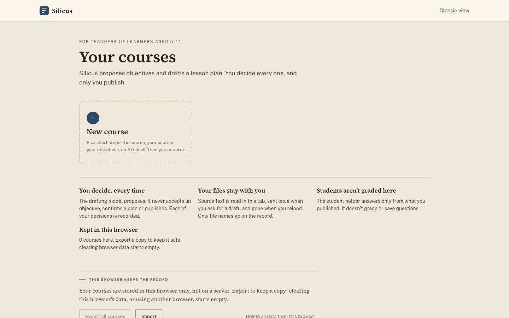
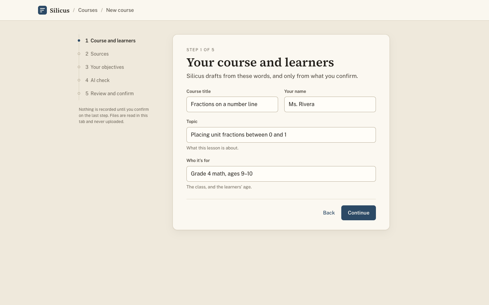
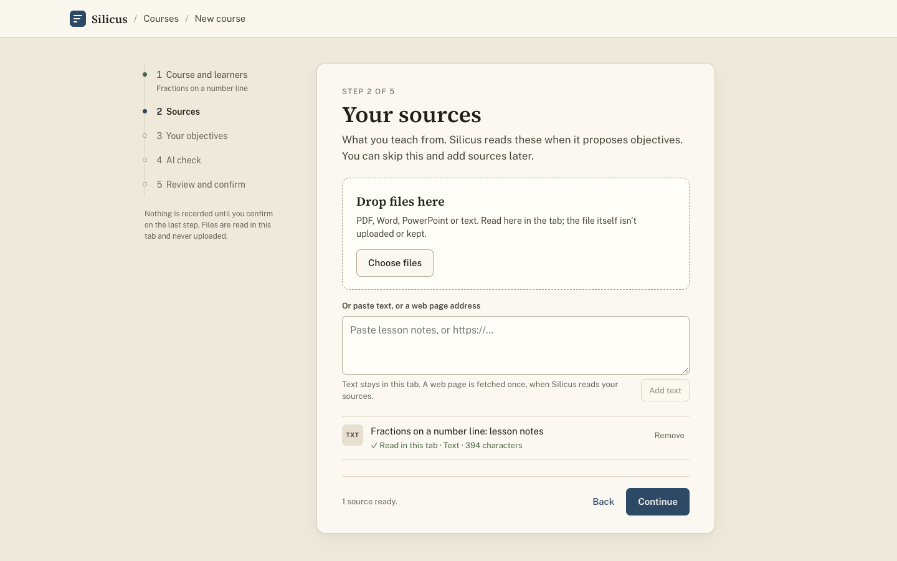
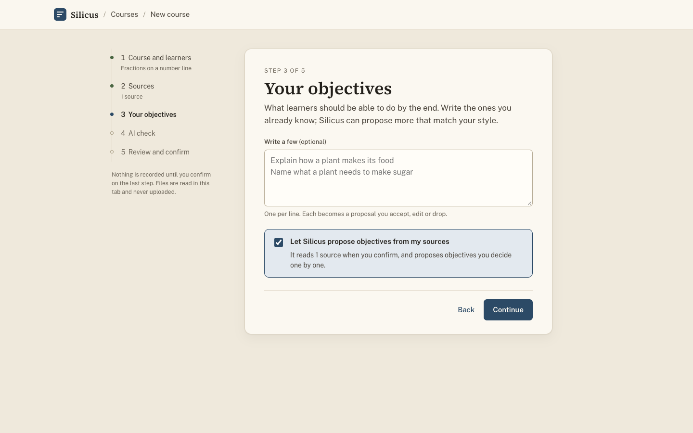
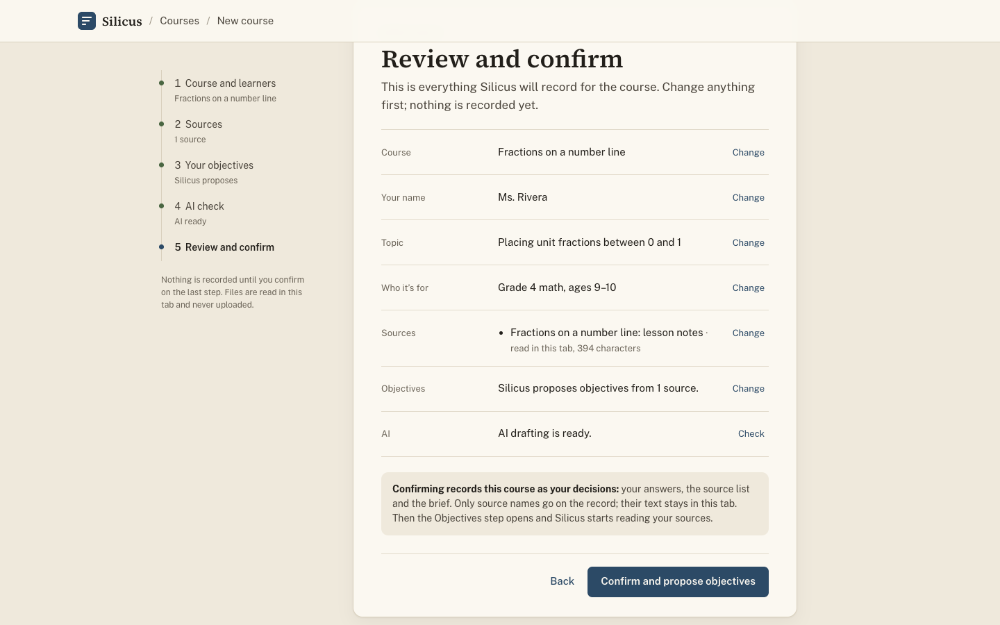
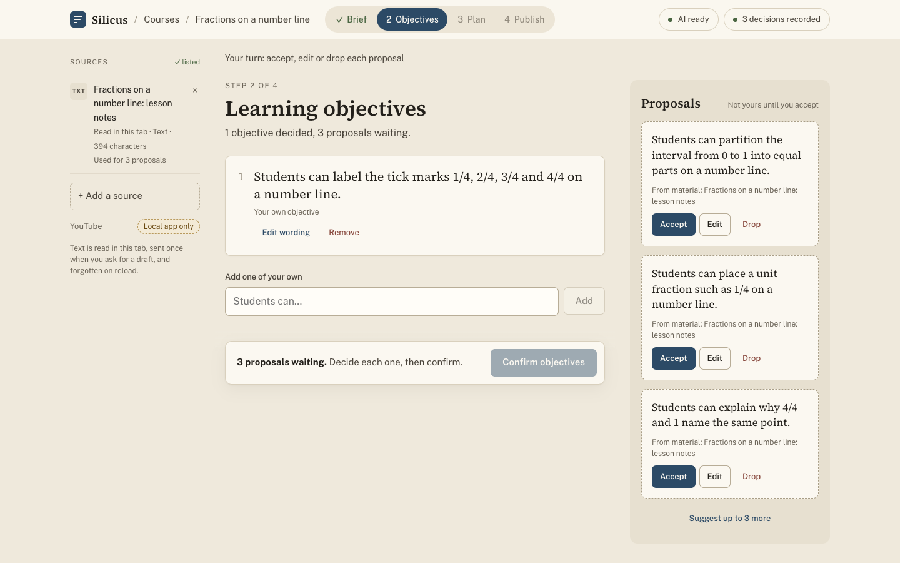
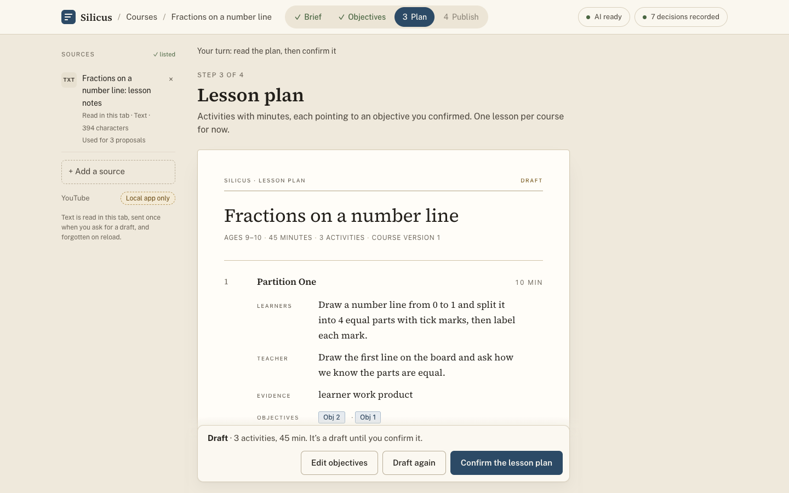
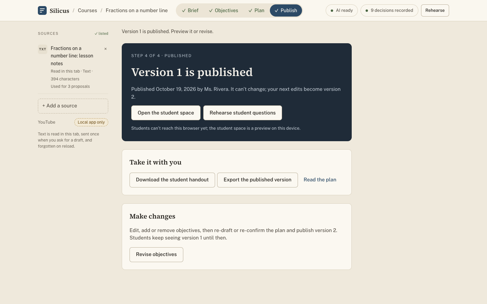
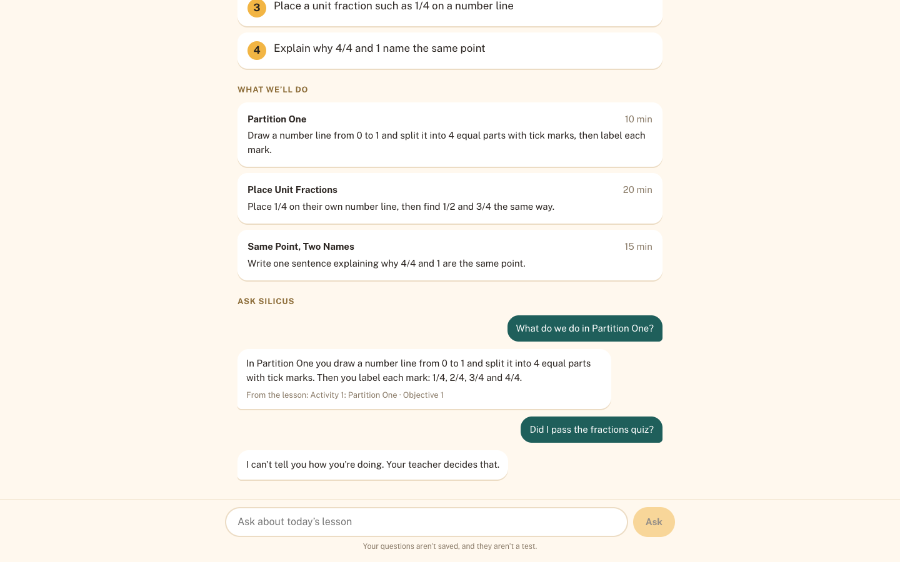
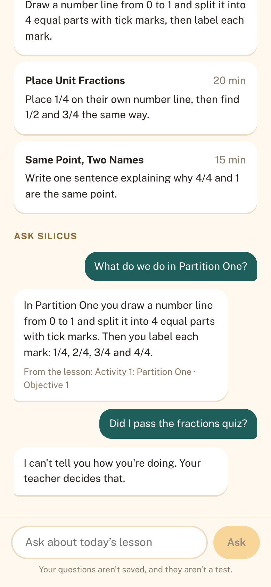

# Silicus TA 3.0

A teacher/student product built on ASFAI Education records and its MCP contract, while staying
compatible with graph ontologies more generally. ASFAI is a protocol, not the model and not the LMS.
AI assists, the teacher confirms: every
objective, plan and published version passes a recorded human checkpoint.

## Install

Three ways to get Silicus in front of a new user:

1. **Try the hosted app** at https://silicus-ta.vercel.app. Ask Augusto for the demo passcode. Courses stay in
   that browser; use Export to keep a copy.
2. **Run it locally** (Node 22 recommended; see "Run it" below). Plain `npm start` runs with the AI worker off.
3. **Self-host on Vercel** from your own fork, with your own key and passcode (`docs/DEPLOY.md`).

**Agents setting this up for someone:** follow [`docs/INSTALL-FOR-AGENTS.md`](docs/INSTALL-FOR-AGENTS.md). It has
the exact commands, what the user must supply, how to check each path worked, the common failures, and the rules
(no secrets in output or commits, no push or deploy without the user's word, ASFAI is optional).

## Walkthrough

A teacher's path through the online app at https://silicus-ta.vercel.app, from an empty browser to a published
lesson and the student preview. The screenshots come from the same build that is deployed
(`VITE_SILICUS_MODE=browser`). The AI steps are answered by a scripted worker, so the pictures repeat exactly; no real
model and no passcode were used. The example is a made-up grade 4 fractions lesson. To take them again:
`node frontend/scripts/capture-walkthrough.mjs`.

**1. Home.** The teacher opens the studio and sees their courses and a New course card. Courses are kept in this
browser; nothing is on a server yet.



**2. Course and learners.** The teacher names the course, themselves, the topic, and who it is for. Nothing is
recorded until the last step of the wizard.



**3. Sources.** The teacher drops files or pastes text or a web address. Silicus reads the text in this tab and keeps
only the source's name on the record.



**4. Your objectives.** The teacher can write objectives here, let Silicus propose them from the sources, or both.
Here the teacher chooses proposals from the one source.



**5. AI check, then review and confirm.** Silicus checks that AI drafting is ready and lists everything it will
record. The teacher's click on Confirm creates the course; that click is the teacher's decision, not the AI's.



**6. Objectives.** Silicus proposes objectives, and each one says which source it came from. They are "not yours
until you accept": the teacher accepts, edits or drops each one, writes their own (the first one here), and then
confirms the list.



**7. Lesson plan.** Silicus drafts a plan from the confirmed objectives only. Each activity has minutes and points to
an objective. It stays a draft until the teacher confirms it.



**8. Publish.** The teacher publishes version 1 after a second, explicit confirm. A published version cannot change;
the next edits become version 2.



**9. Student preview.** The helper answers from what the teacher published and cites the items each answer rests
on. It does not judge how a student is doing; that question goes back to the teacher.



The same preview on a phone (390 × 844):



**What this is not yet.**
- Students cannot open a published course from their own device; the student space is a preview on the teacher's.
- "AI never grades" rests on the prompt, the model's refusal flag and a backstop check that catches only part of it
  (measured; see `docs/STATUS.md`).
- Online, the records live in the teacher's browser. Clearing it loses them; use Export to keep a copy.

## Why it exists

Most course-assistant tools let the model decide. Silicus is the counterexample: confirmation
is an explicit teacher action, recorded with provenance. The AI proposes objectives and a plan;
the teacher accepts, renames, drops, or adds; only the teacher publishes. A student cannot
manufacture evidence by chatting with the bot. "AI assists, never decides" is enforced in code,
not asserted in copy.

## Status

**Current status lives in [`docs/STATUS.md`](docs/STATUS.md).** For what each document is, see
[`docs/INDEX.md`](docs/INDEX.md). The paragraphs below are kept as the 14 October snapshot. Since then the repo
added an online build (browser host plus Vercel), uploads, the studio at `#/studio`, and newer test counts. The
line "the trust core is untouched since Sprint 2" stopped being true on 14 October: `b95afc8` added the `reword`
verb to `confirm-gate/`.

> **Correction (19 October).** "Material never persists" is the intended invariant, not current behaviour: the
> course-creation route stored whatever material fields a client sent. At `6b49604` it keeps names only for new
> writes. Legacy and imported records can still hold raw text (`docs/STATUS.md` §2 item 13). Student
> answers cite the published package; their meaning is not checked against the source (§2 item 14).

*Historical, 2026-10-14:* Working end to end, ahead of a **December 2026 MVP**: one teacher can run the whole story —
name the course → confirm materials → answer the intake questions → confirm the outline and
objectives → a worker drafts the plan → confirm → publish — with or without an ASFAI account
(ASFAI is recommended, never required). Three collaborators (Augusto, Michael, Stephen).

Verification today: confirm-gate 26, host 147, frontend 91, e2e 30/30, and live-browser 50/50
tests passing; the trust core is untouched since Sprint 2. Current status, honest gaps, and the
road to MVP: [`docs/ROADMAP.md`](docs/ROADMAP.md).

## Layout

| Path | What it is |
|---|---|
| `confirm-gate/` | Headless trust core: five-checkpoint state machine + residual rule. Contract in `SPEC.md`. Change nothing here without a failing test first. |
| `host/` | The real transport (zero-dependency `node:http`). Runs the gate server-side, event-sourced, hash-chained log, verified archive. Intents-only API. See `host/README.md`. |
| `frontend/` | Vite + React + TS sidecar app; a thin client of the host. See `frontend/README.md`. |
| `api/` | Three stateless Vercel functions for the online build (model proxy, status, guarded fetch). See `docs/DEPLOY.md`. |
| `eval/` | Student-helper eval harness and fixtures (calls a real model). |
| `docs/` | Contract (`lesson-planning-object.md`), UX scorecard, `research/` (Marble, ASFAI MCP), and `archive/` (dated Oct 2026 MCP smoke-test evidence). |
| `patches/` | Proposed upstream fix for the ASFAI clarification receipt. |

## Run it

From the repository root (each `cd` is inside a subshell, so the working directory does not move):

```sh
# confirm-gate/ needs no install: zero dependencies, plain ES modules, Node >= 18 (dev on 22)
(cd host     && npm install && npm start)     # transport on 127.0.0.1:8787, data in ~/.silicus/host
(cd frontend && npm install && npm run dev)   # GUI workbench at http://localhost:5173 (second terminal)
```

The GUI is a thin sidecar: it reaches the host through a same-origin `/api` proxy in dev and
preview, so the client holds no credentials. Details and the intent-only API: `host/README.md`.

That is the **local app** (the Node host holds the record). The **online app** is the same code built with
`VITE_SILICUS_MODE=browser`: the record lives in the teacher's browser, and only the model call and link fetch
go through Vercel. There is no course-record persistence on Vercel, but source text and questions transit Vercel
and the model provider, whose terms apply (`docs/DEPLOY.md`). The two hosts have different authority. See `docs/STATUS.md` §3.

## Docs

- `docs/STATUS.md` — **current status** (canonical); `docs/INDEX.md` — what every document is, current or historical.
- `docs/ROADMAP.md` — the 14 October plan, honest gaps, and the December MVP cut line (see its superseded banner).
- `docs/DEPLOY.md` — the online build on Vercel: variables, guards, honest limits.
- `confirm-gate/SPEC.md` — the five-checkpoint teacher-confirm contract (the trust core).
- `docs/lesson-planning-object.md` — the four-record / five-checkpoint object contract.
- `host/README.md` and `frontend/README.md` — transport and design-system foundations.
- `docs/research/` — Marble and ASFAI MCP grounding reports.

## Verify

From the repository root:

    (cd confirm-gate && node --test)
    node --test api/test/
    (cd host && node --test)
    (cd host && node scripts/e2e-restart.mjs)
    (cd frontend && npm test && npm run build)
    node frontend/scripts/live-host-smoke.mjs
    node frontend/scripts/browser-mode-smoke.mjs
    node frontend/scripts/studio-smoke.mjs

Passing tests say nothing about the live model path. On 19 October production `/api/worker` was failing upstream
(see the live-service row in `docs/STATUS.md`).

The full command list, with what each one needs, is in `docs/STATUS.md` §3. Results are recorded per sha
under `docs/verification/`.

## Boundaries to preserve

- Silicus is the product surface; ASFAI Education is an independent records/protocol product.
- Teacher confirmation gates publication. AI proposes; it does not decide.
- Marble is optional alignment, not the course store. Local objectives are first-class.
- Student chat is not evidence. Teacher onboarding and student use are separate.
- First real-user slice is ages 5-14; RA and graduate school are parked.
