# Behind the scenes, and a first impression

Branch `feat/rail-tour`. Two standalone components for the stage-focused prototype. They are **not mounted**: card C1 mounts them. Everything the product owner asked to be obvious (what the teacher, Silicus, the drafting model and ASFAI each do in the background) is in these two pieces of the page.

```
frontend/src/components/ActivityRail/
  ActivityRail.tsx          the rail: lane key, rows, the step in flight, one polite live region
  ActivityRail.module.css   tokens only; hairlines; one accent; the one moving thing
  copy.ts                   every sentence, as a pure function of an ActivityItem (+ relative time)
  lanes.ts                  the four lanes, in order, with their wording
  useMediaQuery.ts          wide / reduced-motion as state
  ActivityRail.test.tsx     26 tests
frontend/src/components/FirstRunTour/
  FirstRunTour.tsx          the four-panel modal (PasscodeDialog's pattern)
  panels.ts                 the four panels as data
  FirstRunTour.module.css
  FirstRunTour.test.tsx     13 tests
```

The look is the one in `frontend/README.md`: a well-set book, not a dashboard. Paper and ink, hairlines instead of cards, the serif for the sentence (the record's voice), the sans for chrome, and the one accent only where the teacher acts or the model is working.

## The rail

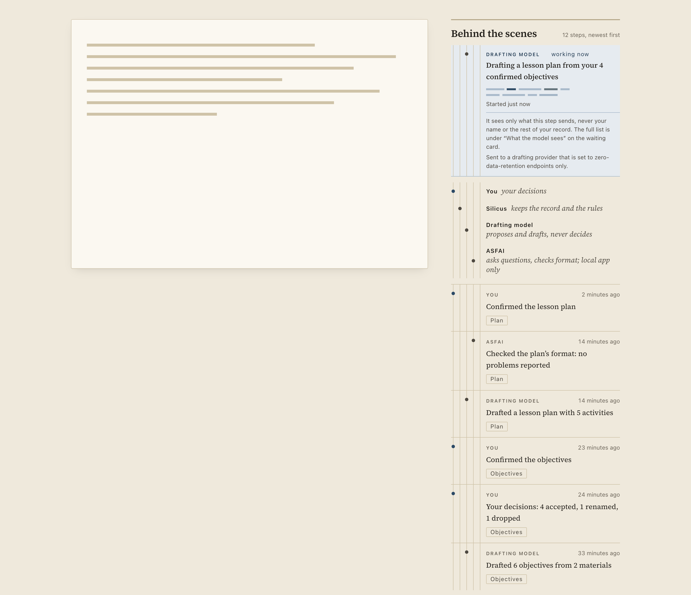

*Local app, 1440 px. The stage is a placeholder sheet. Twelve steps, newest first: the newest six are shown, the other six are one button away. The tinted block is the step in flight.*

Each row is one thing one actor did to one artifact:

- a **dot in the actor's column** (four hairline columns, one per lane; the legend above uses the same columns, so the eye learns the code in one glance). The dot is never the only signal: the actor's name is written on every row. The teacher's dot is the accent, everyone else's is ink;
- the **actor** in small tracked capitals, and a **relative time** ("14 minutes ago"; the exact moment is in the `title`);
- the **sentence**, in the serif;
- the **artifact** it changed, as a small hairline label (Record, Outline, Objectives, Plan, Package).

The four lanes, in this order and wording:

| Lane | Reads |
|---|---|
| You | your decisions |
| Silicus | keeps the record and the rules |
| Drafting model | proposes and drafts, never decides |
| ASFAI | asks questions, checks format; local app only |

### Online there is no ASFAI lane

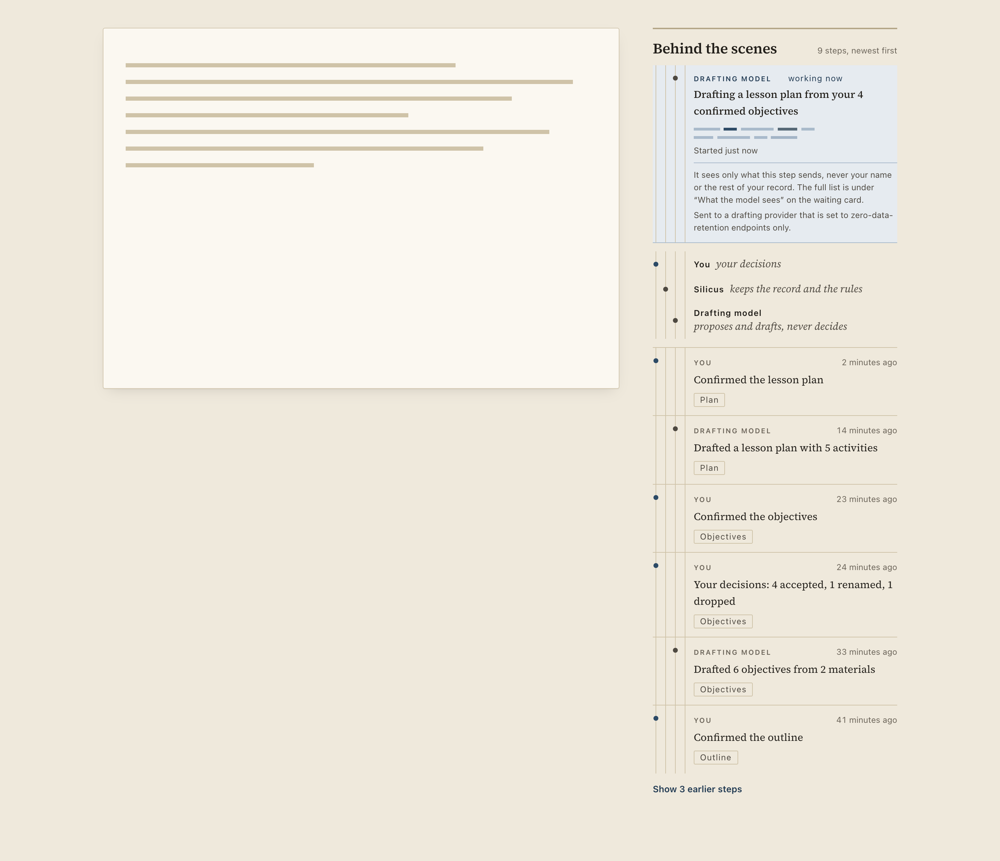

*The same course online. `asfaiAvailable={false}`: no lane, no row and no step for ASFAI, and the word does not appear. Nine steps instead of twelve because the three ASFAI rows are not drawn.*

### The step in flight

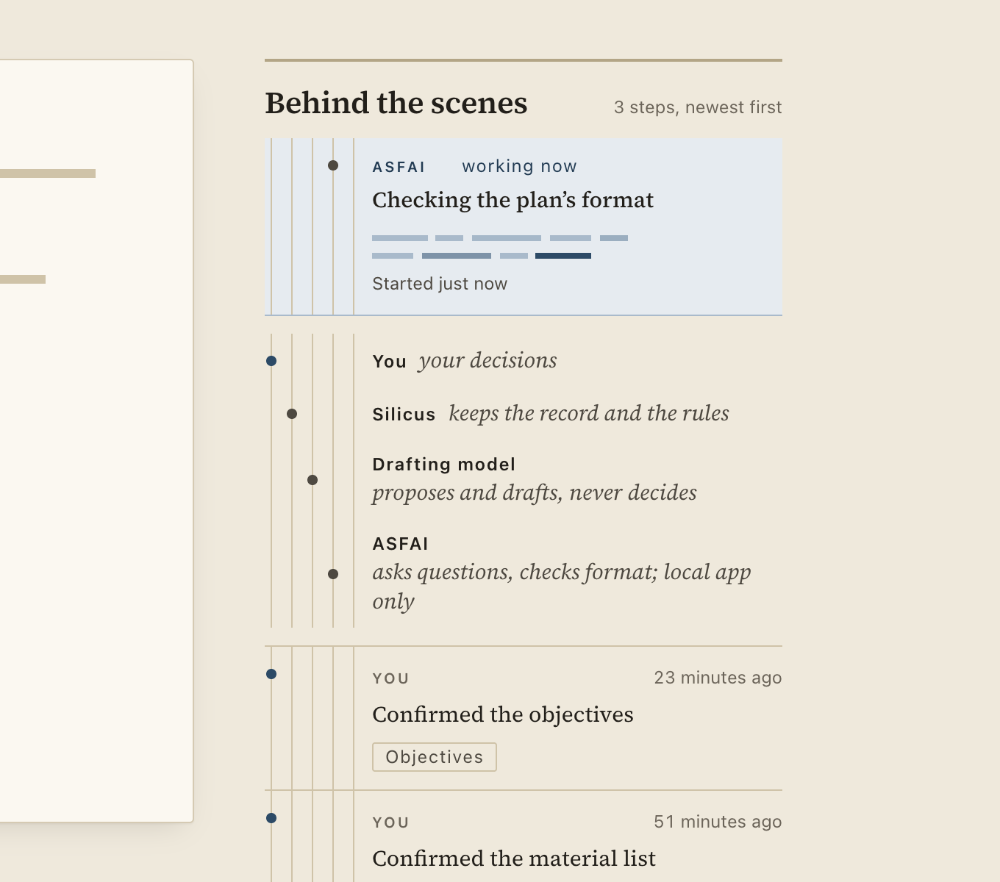

*The step in flight names its actor. Here ASFAI is the actor; the lane key shows all four because ASFAI is available.*

The in-flight block (`now`) is the **one animated element**: two ragged lines of type taking ink, word by word, at scattered moments (the vocabulary of `AiWaiting`, set smaller, and two lines on purpose: one line of dashes reads as a progress bar). There is **no bar, no percentage and no second clock**: the waiting card owns the clock, which holds while the passcode dialog is open, and the rail would not know. The rail says only when the step *started*, and it re-renders that and every relative time twice a minute, quietly (never through the live region).

When the actor is the drafting model, one sentence says what it sees and where the full list is:

> It sees only what this step sends, never your name or the rest of your record. The full list is under “What the model sees” on the waiting card.

This is true for all three steps (`NEVER_BASE` in `AiWaiting/model.ts` is on all three lists). The model's name is shown only if the host sent one. **Zero-retention is said only for `worker.zdr === true`.** For an explicit `false` the rail says it is under the provider's normal data-retention terms; for `null`/unknown it says nothing about retention at all.

Under `prefers-reduced-motion` the ink sits still (`data-motion="still"`, from `matchMedia`, and a CSS media query as a second guard).

### Narrow screens

Below 72 rem the rail is a disclosure under the stage: the title is the 44 px button, "12 steps" is its summary. **The step in flight stays visible while it is closed**, so the one thing that is happening is never hidden.

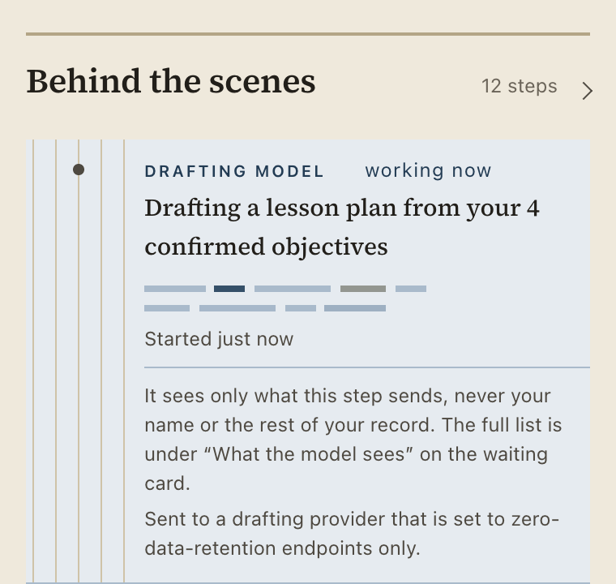

*380 px, closed. The in-flight block is still there.*

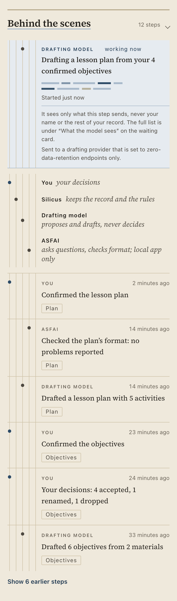

*380 px, open. No horizontal overflow at 380 or 320 (measured: `scrollWidth === clientWidth` at both).*

### The copy table (action → sentence)

The sentence is a verb phrase; the actor is named beside it, so it never repeats who. It is built from `action` and the **numbers** in `facts`. A fact that is missing or malformed drops its clause: nothing is guessed, and `undefined`/`NaN` can never be printed (a test sweeps every action with no facts). Every count goes through `lib/plural.ts`.

| action (actor) | facts read | sentence |
|---|---|---|
| `course.created` (You) | none | Started this course |
| `checkpoint.confirmed` (You) | `checkpoint` | Confirmed the material list / the outline / the objectives / the lesson plan; else "Confirmed a step" |
| `intake.asked` (ASFAI) | `questions` | Asked 3 questions about your course; "1 question"; no count → "Asked questions about your course" |
| `intake.answered` (You) | none | Answered the questions |
| `intake.sent` (ASFAI) | none | Reported that your answers are enough to start drafting |
| `objectives.derived` (Silicus) | `count` | Listed 2 objectives from your own answers |
| `objectives.drafted` (Drafting model) | `count`, `materials` | Drafted 3 objectives from 1 material; "Drafted 1 objective from 1 material"; no counts → "Drafted objectives" |
| `objectives.decided` (You) | `accepted`, `renamed`, `dropped`, `added` | Your decisions: 2 accepted, 1 renamed (zero counts left out); none known → "Decided on the proposed objectives" |
| `plan.drafted` (Drafting model) | `activities` | Drafted a lesson plan with 5 activities; "1 activity"; none → "Drafted a lesson plan" |
| `plan.checked` (ASFAI) | `valid`, `issues` | Checked the plan’s format: no problems reported / 2 problems reported / (unknown) just "Checked the plan’s format" |
| `plan.confirmed` (You) | none | Confirmed the lesson plan |
| `package.sealed` (You) | `version` | Sealed version 1; none → "Sealed a version for students" |
| (unknown action) | none | Did something to the course |

Honesty, by construction and by test:

- the drafting model only ever **drafts** (no row for it contains "confirm", "decid" or "accept");
- nothing says "verified", "secure", "proof", "approved" or a percentage (a test sweeps every sentence);
- ASFAI's format check is reported as what it reported ("no problems reported"), never as an approval, and it is the teacher's lane that "confirms";
- the record is never described as proof; student chat never appears as evidence (it never appears at all: the rail has no row for a student's question).

### The live region

One `aria-live="polite" aria-atomic` element. It is **empty on mount** (history is not read out), written **once when a row is added** ("You: Confirmed the lesson plan."), and when several rows arrive together it names each. A re-render with the same items, the clock ticking, the step in flight starting or ending: none of these write to it. (The waiting card already announces the AI step, so the rail does not.) One known edge: if the rail mounts empty and its first row arrives later, the region mounts with its text and many screen readers stay silent. In practice a course always has its `course.created` row.

## The first-run tour

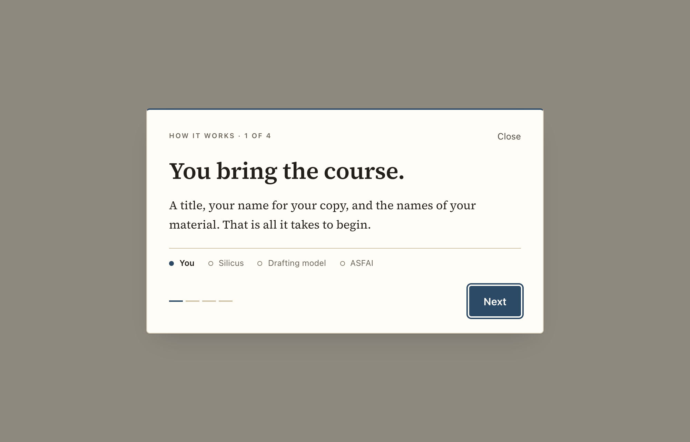

*Panel 1.*

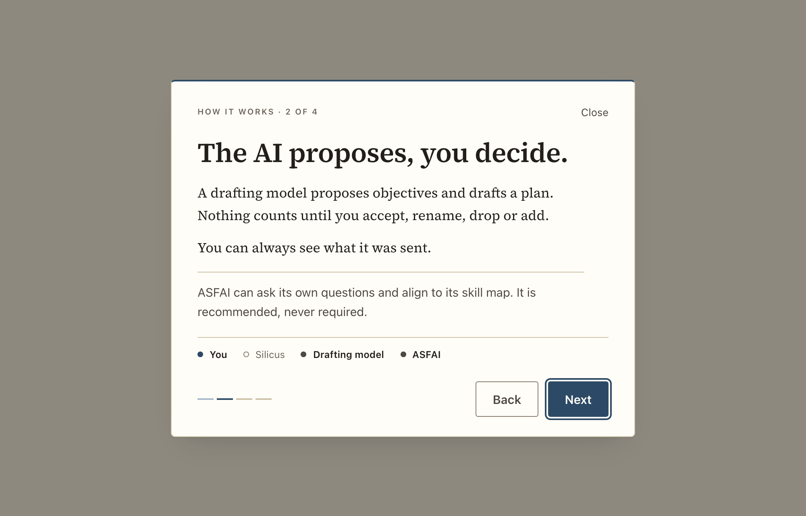

*Panel 2 in the local app: the ASFAI line, and ASFAI joins the cast.*

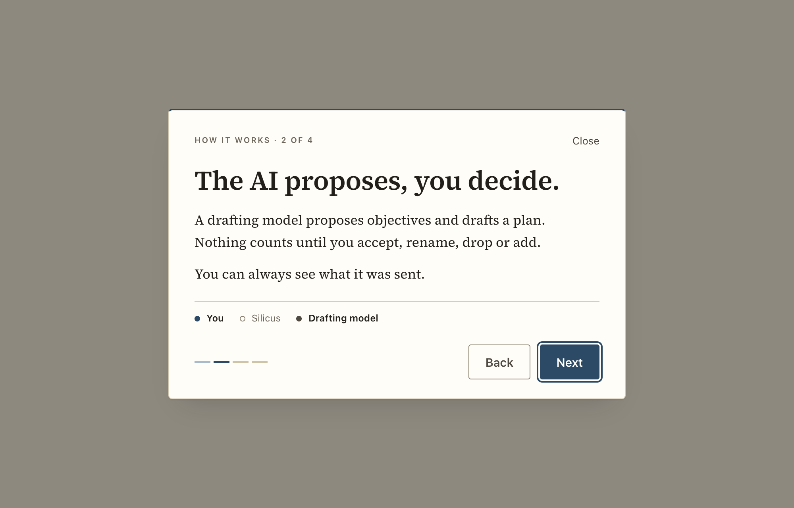

*Panel 2 online: nothing about ASFAI, in the text or in the cast.*

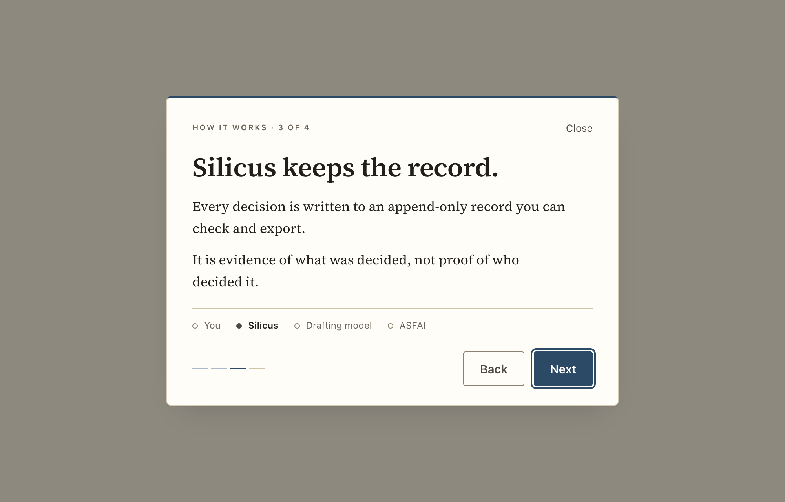

*Panel 3.*

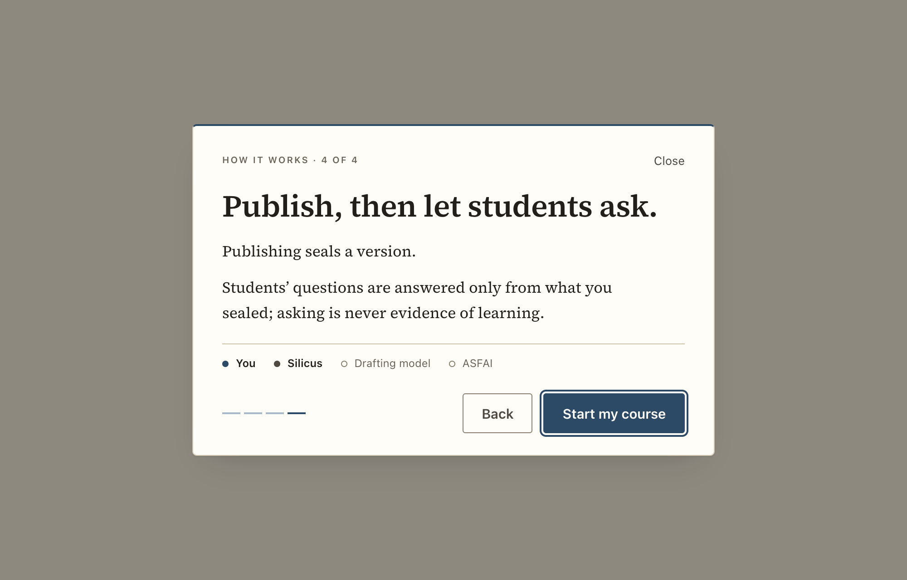

*Panel 4: the last panel's button is "Start my course".*

A modal in the shape of `PasscodeDialog`: `role="dialog"`, `aria-modal`, labelled by the panel's title, described by its text. Focus goes to **Next** when it opens; Tab and Shift+Tab stay inside; **Escape closes**; focus returns to whatever opened it. One polite live region says "Step 2 of 4: The AI proposes, you decide." and focus stays on Next, so a keyboard user can press it again. A visible **Close** (44 px) is always there. It always opens on panel 1.

| # | Title | Text |
|---|---|---|
| 1 | You bring the course. | A title, your name for your copy, and the names of your material. That is all it takes to begin. |
| 2 | The AI proposes, you decide. | A drafting model proposes objectives and drafts a plan. Nothing counts until you accept, rename, drop or add. / You can always see what it was sent. / *(only when `asfaiAvailable`)* ASFAI can ask its own questions and align to its skill map. It is recommended, never required. |
| 3 | Silicus keeps the record. | Every decision is written to an append-only record you can check and export. / It is evidence of what was decided, not proof of who decided it. |
| 4 | Publish, then let students ask. | Publishing seals a version. / Students’ questions are answered only from what you sealed; asking is never evidence of learning. |

Under the words, a quiet **cast** line repeats the rail's four names and inks the ones in this panel (a filled dot), so the tour and the rail teach the same picture. It is `aria-hidden`: the words already say it. The four short ticks at the foot are a place-marker for four leaves, not a measure of any work, and are hidden under 34 rem.

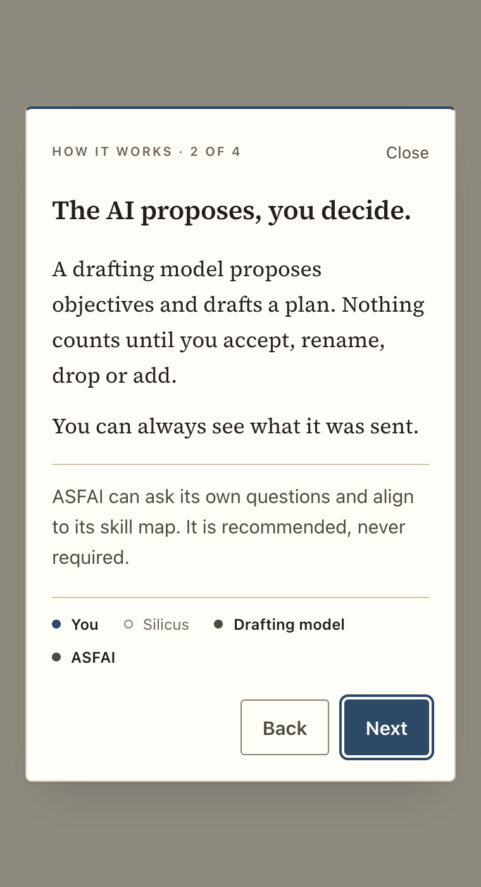

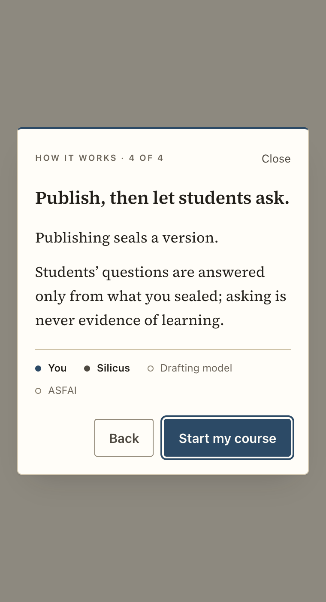

*380 px. The dialog scrolls inside the viewport (`max-height: calc(100dvh - …)`) rather than the page; no overflow at 380 or 320.*

The tour **never stores anything** and never writes the record. Persistence is the parent's: `localStorage["silicus.tour.seen"] = "1"`.

## Mounting it (for C1)

```tsx
import { ActivityRail } from "../components/ActivityRail";
import { FirstRunTour } from "../components/FirstRunTour";

<ActivityRail
  items={view.activity ?? []}
  now={waiting ? { actor: waiting.actor, label: describeStep(waiting.step).title, startedAt: waiting.startedAt } : null}
  worker={workerStatus ? { zdr: workerStatus.zdr, model: workerStatus.model } : null}
  asfaiAvailable={asfaiAvailable}
/>

<FirstRunTour open={tourOpen} onClose={closeTour} asfaiAvailable={asfaiAvailable} />
```

- **Layout.** Wide (≥ 72 rem) the rail is `position: sticky; top: 1.5rem; align-self: start` with its own `max-height` and scroll, so put it in a grid column (22 rem worked well) with `align-items: start`. Narrower it is just a block under the stage.
- **Key by course.** `key={view.course.id}` on the rail: the live region remembers which `seq` it has seen, and `seq` repeats across courses.
- **Persistence and focus** are C1's: set `silicus.tour.seen`, and on "Start my course" focus `#onboarding-reply` (the dialog returns focus to its opener first, so move focus after `onClose` has run, e.g. in a `useEffect`).
- **No new tokens, no new dependencies, no fonts, no network.** Both stylesheets use only existing tokens (`color-mix` of tokens for the scrim, as the passcode sheet does).

## Contract: which `facts` keys the rail reads

The contract says `facts` are "counts, names and flags only" but does not name the keys. The rail reads these (see the top of `copy.ts`); **engineer card E1 should emit exactly these, or this table and `copy.ts` change together**:

| action | keys |
|---|---|
| `checkpoint.confirmed` | `checkpoint: "files" \| "outline" \| "objectives" \| "plan"` |
| `intake.asked` | `questions: number` |
| `objectives.derived` | `count: number` |
| `objectives.drafted` | `count: number`, `materials: number` |
| `objectives.decided` | `accepted`, `renamed`, `dropped`, `added: number` |
| `plan.drafted` | `activities: number` |
| `plan.checked` | `valid: boolean`, `issues: number` |
| `package.sealed` | `version: number` |

Material names and objective wording are deliberately **not** read: the rail is a reading aid, not a second copy of the record. If a key is absent the sentence still reads correctly (see the table above).

## Checked

- **Contrast.** Computed from `tokens.css`: muted on canvas 4.83:1 (the lowest text pair; the rail sits on the canvas); soft on canvas 7.38; ink on canvas 13.57; accent-strong on the accent wash 9.63; soft on the wash 7.44; muted on raised paper (tour) 5.75; the primary button 9.07. Dots against the canvas 7.38 (ink) and 7.62 (accent). The lane hairlines and the artifact label's border are decoration (1.44:1), and everything they hold is also text.
- **Targets.** The narrow disclosure, "Show N earlier steps", the tour's Close, Back and Next all carry `min-height: 44px`; the "Show N earlier steps" button was measured at 44 px in the browser, the rest are set by the stylesheet and not separately measured.
- **Overflow.** Rail at 380 and 320 px, open: `scrollWidth === clientWidth`. Tour at 320: the dialog's `scrollWidth === clientWidth` (278 px).
- **Colour.** `tokens.test.ts` already fails the build on a hex/rgb/hsl value under `components/`; both stylesheets pass.
- **Tests.** 39 new (26 + 13). Each was seen failing first (the modules did not exist), then passing. Frontend total 325 (baseline 286). Teeth: eleven deliberate mutations (zero-retention loosened to `!== false`, the ASFAI lane drawn online, ASFAI rows not filtered, history announced on mount, every row re-announced, plural dropped, motion ignoring reduced-motion, focus not trapped, Escape not closing, focus not returned, the ASFAI line shown online) were each caught by a test, and the files restored.

The screenshots were taken from a temporary harness (a throwaway page with made-up course data and a placeholder sheet for the stage), served by `vite dev` and driven by puppeteer-core on system Chrome. The harness was deleted and is not in the branch.
