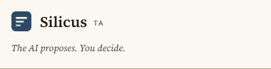
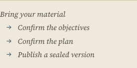
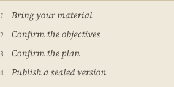

# Narrow widths: the shell holds from 320px

Branch `fix/narrow-shell`. The product owner opened `#/live` in a narrow window and reported "the UI seems
broken": elements squeeze onto one line, text and buttons clip at the edges. This branch is the shell, the
landing and the intake surfaces; the decision / plan / publish cards are a parallel round.

> **Merged, and re-measured.** This page began as the shell round (`fix/narrow-shell`). The cards round
> (`fix/narrow-cards` — DecisionCard, PlanCard, PublishCard, TimelineCard) landed on top of it, so the
> shipped artifact is the merge. The **before** column below is unchanged and still reproduces on `main`
> (`e33844f`). The **after** column, the defect/after table and the paragraph under them were re-measured on
> the merged branch with `node frontend/scripts/narrow-shell.mjs`, and the numbers changed: the merged page
> does not scroll sideways anywhere. The two rounds also happen to use **different** narrow breakpoints —
> `40rem` in the shell's sheets, `34rem` in the cards' — which is stated in full under the table.


*Before. Below 640px the header was the wordmark and nothing else — the promise line had been hidden by a
breakpoint, so the header read as half-finished.*



*After. The promise is set under the wordmark like a standfirst. Nothing is dropped; nothing is squeezed.*

## How it was measured

`frontend/scripts/narrow-shell.mjs` — a copy of `browser-mode-smoke.mjs`, adapted for layout. It builds the
app with `VITE_SILICUS_MODE=browser`, serves it with **exactly** the headers `vercel.json` sets (strict CSP
included) and the same two mock functions, then drives the whole teacher story through the UI (name the
course → confirm materials → answer the intake → paste material → propose → accept → draft → confirm →
publish → a student asks) so every surface a teacher can reach is on the page. At each width it records:

- `documentElement.scrollWidth` vs `clientWidth` — does the page scroll sideways;
- **every element whose right edge passes the viewport's right edge** (and any starting left of it), named by
  stable structure (aria-labels and tags, never a hashed CSS-module class), with its ancestor chain;
- **every element whose own box is smaller than its content** (`scrollWidth > clientWidth`) — text or a button
  label being cut off. A deliberately hidden control (the 1px file input) is not counted as a clip.

It exits non-zero if any surface this round owns overflows. The model is instant here: this harness measures
layout, not timing.

```sh
node frontend/scripts/narrow-shell.mjs                    # 320, 380, 480, 768, 1440
NARROW_SHELL_WIDTHS=380 node frontend/scripts/narrow-shell.mjs
NARROW_SHELL_SHOT_SUFFIX=after SILICUS_SMOKE_SHOTS=docs/design/img node frontend/scripts/narrow-shell.mjs
```

## The defects, with evidence (before)

Every row below is from the harness on `main` at `e33844f`, at the width in the second column. "Mine" counts
overflowing elements on the surfaces this round owns; the page also carried overflows inside the cards, which
belong to the parallel round.

| # | Surface | Width | Evidence (before) | Cause |
|---|---|---|---|---|
| 1 | Masthead | ≤ 640 px | "The AI proposes. You decide." was **gone**: `@media (max-width: 40rem) { .tagline { display: none } }`. The header was a wordmark with an empty right half | A breakpoint hid the product's first honesty claim instead of re-setting it |
| 2 | Hero steps line | 380 px | Four stacked lines; lines 2–4 each began with a dangling `→` | The inline arrow chain wrapped mid-phrase, and the arrow stays with the wrapped item |
| 3 | Stage header (course title + meta) | 320 px | `h1`, `p.sub` and their wrapper: left 52 → right **347** (295 px wide) in a 320 px viewport | The wrapper had no `min-width: 0`, and `.sub` carries an unbreakable `urn:uuid:…` — the token set the row's minimum width |
| 4 | Course library row | 320 px | Row content 214 > box 182 | The row's text column had no `min-width: 0`, so the long title's minimum width pushed the row |
| 5 | Materials panel | 320 px | The whole section: left 52 → right **328** (276 px) where 216 px was available; the file input alone was 276 px | `input[type=file]`'s own default width set the card's minimum, and the panel — a flex item in a row of buttons — could not shrink below it |
| 6 | Pinned copies row | 380 px | Status span left 290 → right **402**; row content 328 > box 234 | `.pinRow` is a four-column grid, `3rem 9rem 7rem 1fr` — 340 px of fixed columns, wider than the viewport |

| State | 320 | 380 | 480 | 768 | 1440 |
|---|---|---|---|---|---|
| landing + onboarding | 0 | 0 | 0 | 0 | 0 |
| onboarding, intake question | **4** | 0 | 0 | 0 | 0 |
| materials panel | **25** | 0 | 0 | 0 | 0 |
| full live course | **6** | **2** | 0 | 0 | 0 |
| record band, delete confirm | **6** | **2** | 0 | 0 | 0 |

*Overflowing elements on the surfaces this round owns, before. The landing itself was never the problem — the
product owner's report was about the surfaces a course opens up.*

## What changed

One breakpoint throughout the shell's sheets — `40rem`, the project's own — across `Workbench.module.css`
(the shell), `LiveCourse.module.css` (stage header, pins, hero), `OnboardingChat.module.css` (the shared
intake sheet used by the onboarding card, the material panel and the student chat) and
`CourseLibrary.module.css`. (The cards round that merged on top of this one switches its own sheets at
`34rem`; see the note under the table.)

**The masthead keeps its promise.** The `display: none` is gone; the masthead wraps, and below 40rem the
tagline takes its own line under the wordmark at `--text-sm`. A promise is not chrome.

**The steps line becomes a numbered ledger.** Below 40rem it stops being an arrow chain that wraps mid-phrase
and becomes what the markup always said it was — an `<ol>` — with a counter, hairline spacing and the serif
italic text unchanged. Above 40rem the arrow chain is untouched.



*Before. Three of four lines start with a dangling arrow.*



*After. The list's own order, set like a contents page.*

**Nothing sets its own minimum width.** `min-width: 0` on the wrappers that hold teacher-written text (the
stage header's title block, the library row's text column, the material panel itself); `max-width: 100%` and
`width: 100%` on the text fields and the file chooser; `max-width: 100%` on every verb, so a long label wraps
its own words instead of running past the page.

**Teacher-written text can break anywhere.** `overflow-wrap: anywhere` on the title, the meta line (which
carries an unbreakable urn), the pin digests and details, the transcript's said lines and standing notes, and
the library's title and meta. `anywhere`, not `break-word`, because these elements are flex and grid children
whose minimum size would otherwise stay the longest word's.

**The pin row stacks.** Below 40rem the four fixed columns become two lines: `v1 … NOT CHECKED`, then the
digest and what it says.

**The rhythm tightens, the measure does not.** Below 40rem the stage's gutters come in from 32px to 16px and
the cards' from 20px to 16px, and the page's vertical pauses shrink — so a 320px window keeps a ~190px
measure inside the card and a ~224px column on the page instead of spending 60% of its width on margins.

## Before / after

| State | Width | `scrollWidth` vs `clientWidth` | Overflowing on my surfaces |
|---|---|---|---|
| landing + onboarding | 320 | 320 / 320 → 320 / 320 | 0 → **0** |
| onboarding, intake question | 320 | 971 / 320 → 320 / 320 | 4 → **0** |
| materials panel | 320 | 971 / 320 → 320 / 320 | 25 → **0** |
| materials panel | 380 | 971 / 380 → 380 / 380 | 0 → **0** |
| full live course | 320 | 600 / 320 → 320 / 320 | 6 → **0** |
| full live course | 380 | 600 / 380 → 380 / 380 | 2 → **0** |
| full live course | 480 | 600 / 480 → 480 / 480 | 0 → **0** |
| full live course | 768 | 768 / 768 | 0 → **0** |
| full live course | 1440 | 1440 / 1440 | 0 → **0** |
| record band, delete confirm | 320 | 600 / 320 → 320 / 320 | 6 → **0** |
| record band, delete confirm | 380 | 600 / 380 → 380 / 380 | 2 → **0** |

On the merged branch the page never scrolls sideways, at any width, and the shell's own surfaces report zero
overflowing elements everywhere. What `narrow-shell.mjs` still marks `(not mine)` is the cards' sheets at
**320px only** — TimelineCard's and DecisionCard's inner rows (14 elements on the full-course and record-band
views, which share the same card stack) whose own box is narrower than the content it holds. That is the
harness's broadest predicate: any element whose `scrollWidth` exceeds its `clientWidth`, whether or not it
hides the overflow. The smoke's stricter predicate — content hidden by `overflow`, or a clipped control
label — reports zero there, and the page never gains a sideways scroll. At 380px and up the cards are clean
under both.

The two rounds chose different narrow breakpoints and the merged page keeps both: the shell's sheets
(`Workbench`, `LiveCourse`, `OnboardingChat`) switch at `40rem`; the cards' (`DecisionCard`, `PlanCard`,
`PublishCard`, `AiWaiting`) at `34rem`; and the waiting card adds a `40rem` rule of its own so its greeked
lines of type rest rather than clip. Nothing depends on the two values agreeing — the cards are narrower than
the page, so their content re-sets a little earlier — and the wide design is untouched above `40rem`.

## Proof (380px, cropped to the surface)

| Surface | Before | After |
|---|---|---|
| Masthead | [before](img/narrow-380-shell-header-before-landing.png) | [after](img/narrow-380-shell-header-after-landing.png) |
| Hero steps line | [before](img/narrow-380-hero-steps-before-landing.png) | [after](img/narrow-380-hero-steps-after-landing.png) |
| Onboarding card | [before](img/narrow-380-onboarding-card-before-landing.png) | [after](img/narrow-380-onboarding-card-after-landing.png) |
| Materials panel | [before](img/narrow-380-materials-panel-before-materials.png) | [after](img/narrow-380-materials-panel-after-materials.png) |
| Student chat | [before](img/narrow-380-student-chat-before-course.png) | [after](img/narrow-380-student-chat-after-course.png) |
| Record band ("this browser keeps the record") | [before](img/narrow-380-record-band-before-landing.png) | [after](img/narrow-380-record-band-after-landing.png) |
| Data controls, confirm state | [before](img/narrow-380-record-band-before-confirm.png) | [after](img/narrow-380-record-band-after-confirm.png) |
| Pinned copies | [before](img/narrow-380-pinned-copies-before-course.png) | [after](img/narrow-380-pinned-copies-after-course.png) |

## What is held by a test

`frontend/src/live/narrow-width.test.tsx` — 10 tests. jsdom applies no CSS-module rules and no media queries,
so the layout itself is proved in real Chrome by the harness; what is pinned here is the contract that made
the narrow window broken, so it cannot come back quietly:

- the masthead's promise is never hidden by a breakpoint, and the masthead wraps;
- one narrow breakpoint (`40rem`) in every sheet it touches;
- the classes holding the teacher's own words declare `overflow-wrap: anywhere`;
- no control declares a width without `max-width: 100%` (text fields and the file chooser take the column);
- the wrappers that can sit in a row of buttons declare `min-width: 0`;
- the pin row has a stacked narrow fallback; the steps line has its numbered fallback;
- **the honesty copy is byte-for-byte what it was** on the surfaces touched here — the material's retention
  sentence, the plain truth when the worker is not zero-retention, and the student chat's "Asking here is not
  evidence of learning, and nothing you ask is saved."

## Copy

**No copy changed.** Not one word on the surfaces this round touches: the masthead's promise, the hero's
assurance line, the onboarding's "on this device" and "not sent to ASFAI" lines, the material panel's
retention paragraph, the student chat's not-evidence sentence, the record band's "this browser keeps the
record". The only text that moves is the steps line's arrows becoming the list's own numbers below 40rem,
which is typesetting, not wording.

## Notes for the next round

- **No token or base-style change was needed.** Every fix lives in the component sheets; `tokens.css` and
  `base.css` are untouched (both are fenced anyway).
- **The record band needed no rule**, and it is fenced: `BrowserRecord.module.css` sits under
  `frontend/src/browser/*`, which this round may not edit. It measured clean at every width and in both
  states (idle and delete-confirm), so nothing was left undone — but if a future change to that band breaks
  at a narrow width, it cannot be fixed from this branch's fence.
- **`.actions`** in `LiveCourse.module.css` is a row of buttons that also carries the material panel. That is
  why the panel needed `min-width: 0`: a card in a row of buttons is sized by its widest control unless it is
  told it may shrink. Worth remembering before adding another card to that row.
