# The waiting experience, and a first impression

Branch `feat/waiting-ux`. An AI step takes 5–25 s (it was up to 53 s). Before this branch the teacher saw
nothing: the button stayed as it was, no word, no clock.

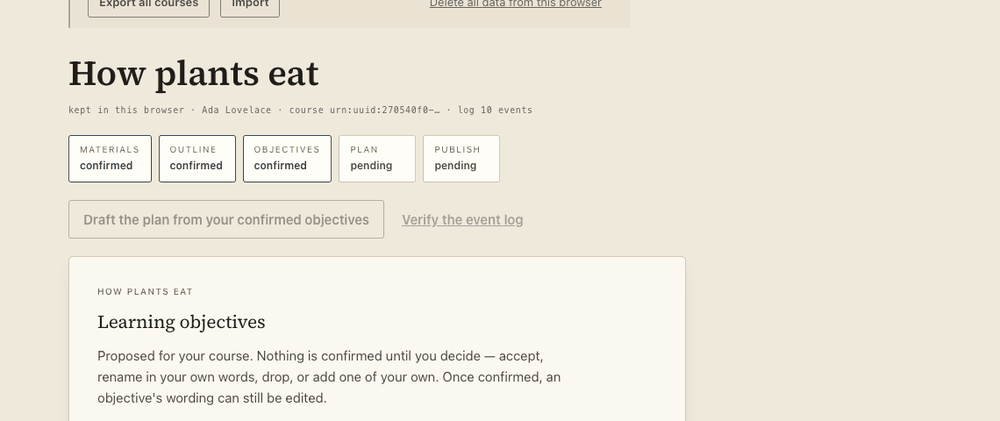

*Before. 2.5 s after pressing "Draft the plan from your confirmed objectives". The page is unchanged.*

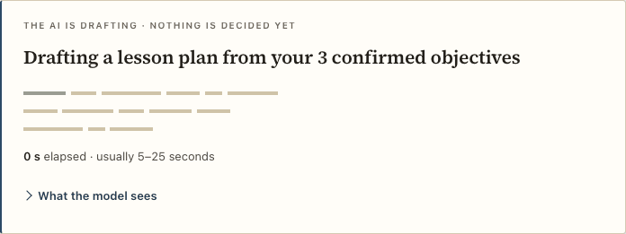

*After, 0 s in. The title counts real things; the clock is real; the range is the usual one, not a promise.*

## What was built

One component, `frontend/src/components/AiWaiting/`, used for every AI step:

| Step | Where it shows | Title (from the view) | Range key |
|---|---|---|---|
| Propose objectives (material, including a link the site reads first) | card, above the actions | "Proposing learning objectives from your 1 text and 1 link" | `objectives` |
| Draft the plan (also from the revision panel) | card, above the actions | "Drafting a lesson plan from your 6 confirmed objectives" | `plan` |
| A student's answer | compact line inside the student chat | "Looking in version 1 for an answer" | `answer` |

```
AiWaiting.tsx          the component (clock, live region, disclosure, receipt)
AiWaiting.module.css   tokens only; the type-setting motion; still under reduced motion
model.ts               everything it SAYS, as pure functions of data the page already holds
AiWaiting.test.tsx     39 tests (see "Tested")
```

`LiveCourse` owns the step: `startWait(step)` when an AI call begins, `finishWait(...)` when the view comes
back. The receipt belongs to the moment: the next act the teacher takes (`run`) removes it, because
"None is confirmed until you decide" stops being true the moment they accept one.

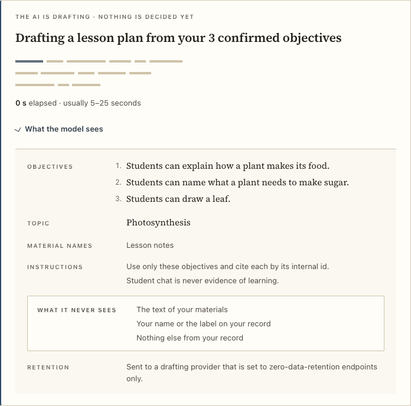

### Lines of type, not a spinner

Three lines of greeked type (square-cornered strokes the width of words). Each word takes ink at its own
scattered moment and dries; the order is a fixed shuffle, so **nothing sweeps left to right** and the
motion cannot be read as progress. Under `prefers-reduced-motion` (CSS media query *and* a
`data-motion="still"` attribute from `matchMedia`) there is no animation at all: the lines sit at rest.
The words above them still change.

## The honesty rules

| Rule | How it is kept |
|---|---|
| No fake progress | No bar, no percentage, no step count. A test fails on any `progress`, `meter`, `role=progressbar` or `%`. |
| Plain words, real numbers | Titles count items in the view (`6 confirmed objectives`, `1 link`, `version 1`). |
| A real clock | `Date.now()` deltas every 250 ms, shown as whole seconds. It **holds while the passcode dialog is open**: the teacher typing a passcode is not the model working. The card then says "Waiting for your passcode. The clock is held until you continue." |
| The usual range is the status field's, else the documented defaults | `typicalSeconds` from `GET /api/worker/status`; absent or malformed (`[30,10]`, strings, NaN, negatives) → exactly `objectives [3,15]`, `plan [5,25]`, `answer [2,8]`. Shown as "usually 5–25 seconds". |
| "Longer than usual" only when true | Appears when elapsed seconds > the high end, never before. It says "It stops by itself within two minutes, and nothing you have recorded is lost." No colour alarm: ink on paper, one hairline above. |
| "What the model sees" is exact | Derived only from the page's own data (below). Each list is what `host/worker.mjs` really puts in the prompt. |
| Zero-retention only on `zdr === true` | The ledger's "Retention" row says nothing when the status is unknown, "normal data-retention terms (not zero-retention)" when `false`, and the zero-retention sentence only for an explicit `true`. |
| One polite live region, two writes | At start ("Drafting a lesson plan from your 6 confirmed objectives. Usually 5 to 25 seconds.") and at finish ("Finished after 12 s. Checked: …" / "Stopped after 7 s."). The clock is not live. A test advances 20 s and asserts the region was written exactly once. |
| The AI never decides | Eyebrow: "The AI is drafting · nothing is decided yet" → "Done · nothing is decided yet". The title changes tense when it finishes ("Drafted …") so *Done* and the sentence agree. The receipt says "It stays a draft until you confirm it." |
| Material never persists | The material list is read from the panel's in-memory state; nothing is written anywhere. Only counts and names are kept in the waiting state, and it is memory-only. |
| Student chat is use, not evidence | The student step shows the question and counts; nothing is stored. The smoke still asserts the stores are identical before and after an ask. |

### What the model sees (derived from the page, checked against the wire)

| Step | Sent (listed) | Source in the page | Never |
|---|---|---|---|
| plan | confirmed objective statements (numbered), the topic, the **names** of listed materials, fixed instructions; in the local app also "reference notes" when a source matches | `view.objectives`, `view.intake.answers.topic`, `view.course.materials[].name` | the text of materials; your name/label; "nothing else from your record" |
| objectives | each material as `name · N characters` (a link as "the site reads this page first"), topic and course name, fixed instructions | the panel's in-memory items, `view.intake.answers` | your objectives, decisions, timeline; your name/label |
| answer | the question, the last ≤ 6 messages, version N (title, its objectives and activities, word for word), fixed instructions | the chat's turns, the sealed version in the view | anything changed since version N; pasted material; your name/label |

The browser smoke closes the loop: after the plan step it reads the request body that really left the
page (`api.workerBodies`) and asserts every listed statement, the topic and the material name are in it,
and that the teacher's label ("Ada Lovelace") and the pasted-text secret are **not**.

## The receipt (computed from the resulting view)

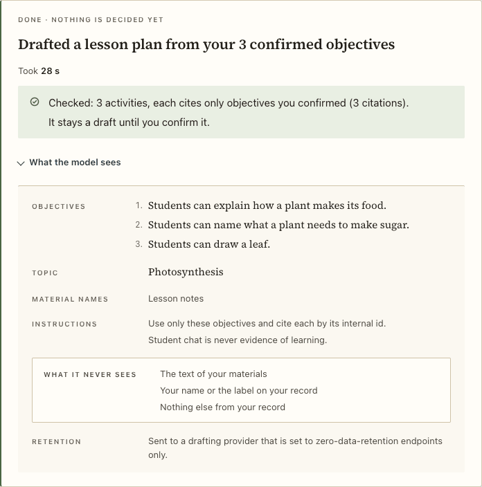

* **Plan**: `Checked: 5 activities, each cites only objectives you confirmed (9 citations).` The page
  re-checks every citation against `view.objectives`. If one cites something else it says so
  ("2 of 3 activities cite something other than your confirmed objectives. Read the plan closely before
  you confirm it."). It also names confirmed objectives that no activity covers, and closes with
  "It stays a draft until you confirm it." (only while the plan is a draft).
* **Proposals**: `6 proposals. None is confirmed until you decide.` plus
  `Drawn from 2 materials (4,210 characters read).` from `view.materialsUsed`. If some are already decided
  it says how many still wait instead of "none".
* **Student answer**: nothing extra: the answer is the result.
* **Stopped**: "Stopped after 7 s." with no receipt; the host's own refusal text stays in the notice.

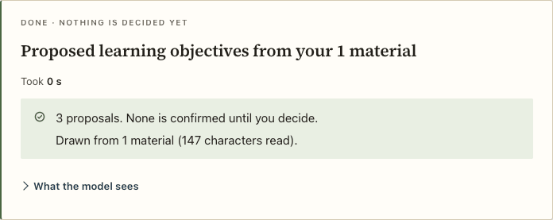

When it takes longer than usual:

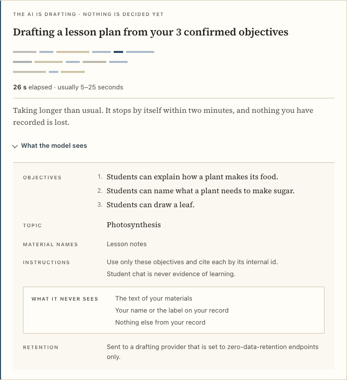

The compact variant, in the student chat:

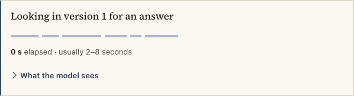

## First impression (online build)

In `VITE_SILICUS_MODE=browser` the bare URL opens the live course (host mode keeps opening on the
decision card; no existing assertion needed editing). The header is a masthead, "Silicus TA" with the
three-lines-of-type mark and one line of promise ("The AI proposes. You decide."), not "design workbench ·
tokens-first". A quiet footer carries the way back to the component workbench ("Design system" →
`#/decision`); on a workbench tab the old tab bar returns, with "Back to the course". The page has a
title ("Silicus TA · course authoring, teacher in the loop") and an inline `data:` SVG favicon (the CSP
allows `data:` images). The empty state is a title page: kicker, one sentence of product, the four moves
as one italic line, one trust sentence, then the first question.

| Before | After |
|---|---|
| 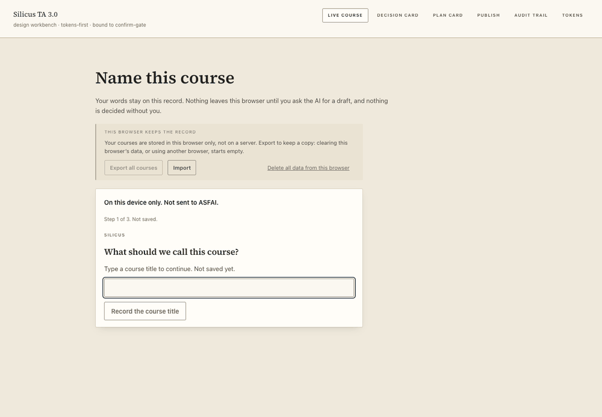 | 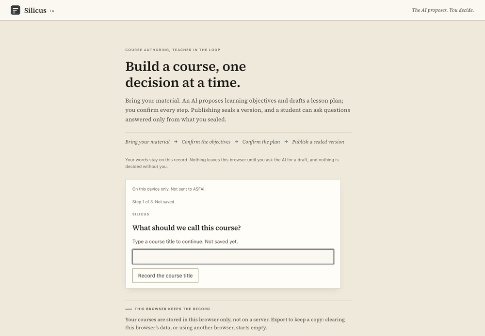 |

## Polish pass

* **"This browser keeps the record"** is a ruled colophon instead of a sunken box: one accent dash, the
  same sentence, three quiet acts, the irreversible one apart. It sits below the first question on the
  empty page and at the foot of a course (it had pushed the course title down). "Export all courses" says
  why it is off ("Nothing to export yet…"). The delete confirmation is its own tinted block and the safe
  choice ("Keep them") holds focus, as in the decision card; focus returns afterwards. Results carry a mark
  (✓ / !), never colour alone.
* **Passcode dialog**: a darker, blurred scrim; one focus treatment (border + halo) instead of two
  outlines; equal-width buttons; "Before the AI drafts" eyebrow; a line saying "Not now" sends nothing;
  focus is trapped inside while it is open and returns to where it was. The title and the copy that tests
  rely on are unchanged.
* **Material panel**: field labels are small caps instead of display-size prompts; each input group is a
  ruled field; the YouTube note is the input's `aria-describedby` hint; the native file button is styled;
  the name/text boxes have placeholders; material rows put "Remove" beside the item; the 8-item limit now
  says so instead of silently dropping the ninth.
* **Empty / error states**: the "browser storage blocked" and "host not running" states get a title and
  `role="alert"`; "AI drafting is not set up on this site" becomes a quiet standing note, not a stray line.
  The standing "On this device only" line is demoted so the question is what the eye finds.
* The live column is 46 rem and centred: the library, pins and cards no longer end at three different widths.

| Before | After |
|---|---|
| 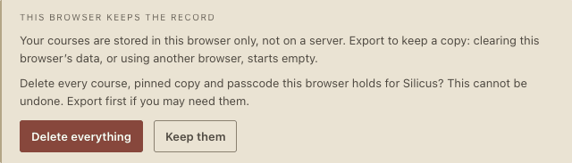 | 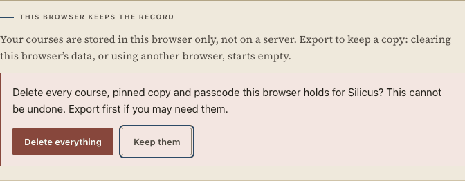 |
| 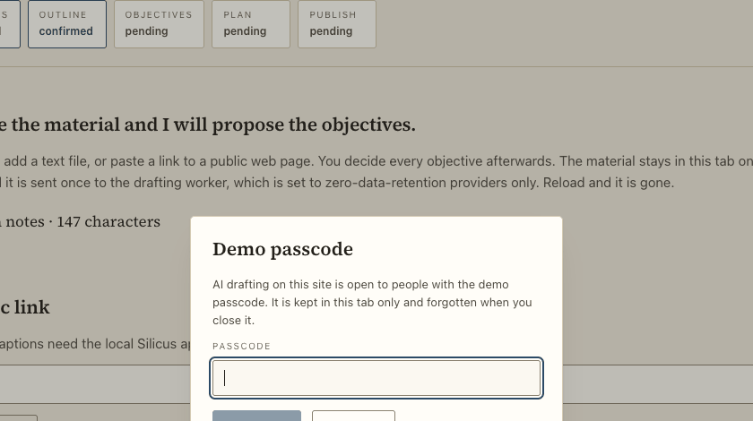 | 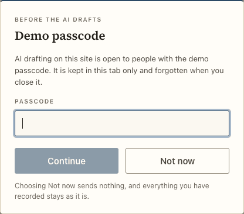 |
| 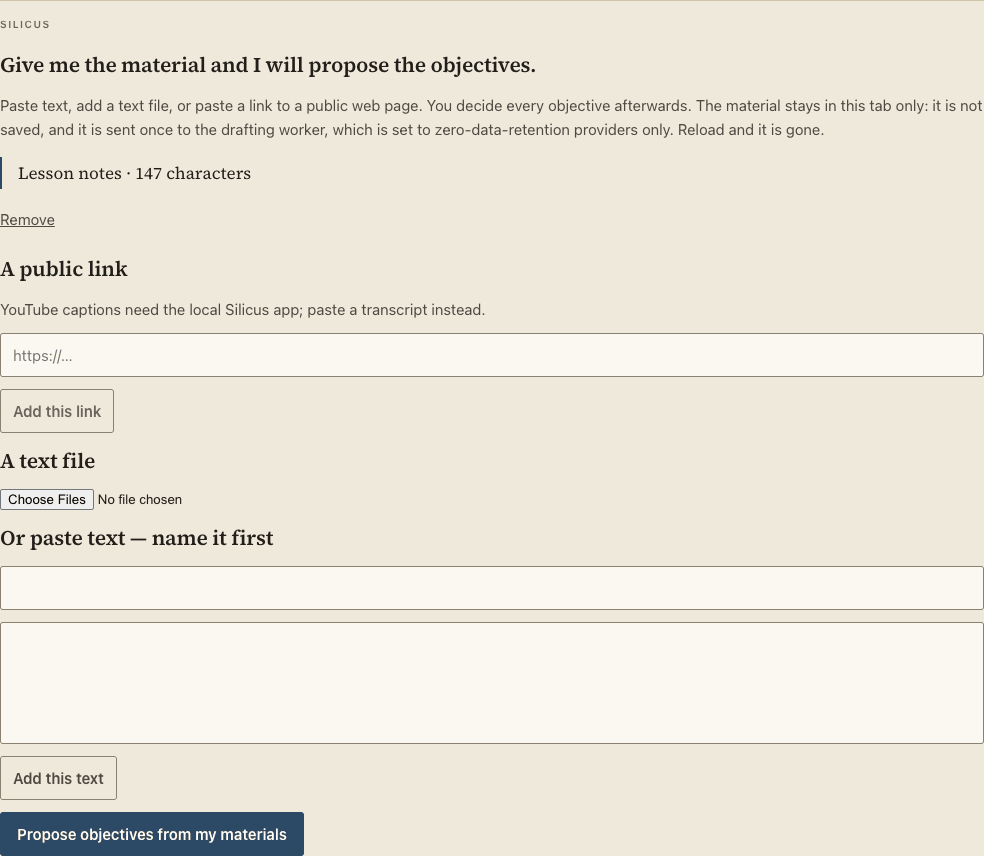 | 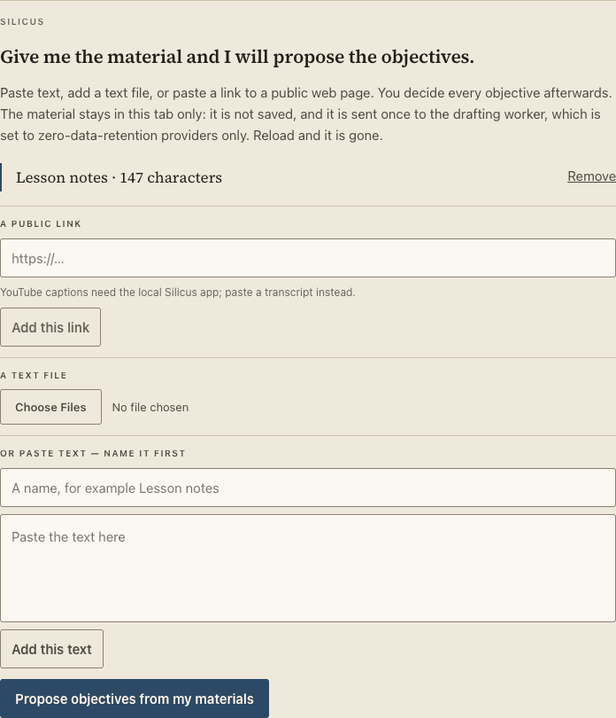 |

## Tested

* `AiWaiting.test.tsx` (39): title with the right count (and singular); elapsed advances (fake timers) and
  holds while the passcode dialog is open; range from `typicalSeconds` and from defaults when absent,
  malformed ranges ignored; the "longer" line only after the high end; "What the model sees" lists exactly
  the sent items (plan, objectives, answer) and opens from the keyboard; reduced motion; one live region,
  two writes; receipts from a view (counts, stray citation, uncovered objectives, singular, none confirmed,
  teacher's own objectives ignored); AA contrast for every text pair the card sets.
* `browser-mode-smoke.mjs`: the mocked `/api/worker` takes `SILICUS_SMOKE_PLAN_MS` (default 2000) to
  draft a plan and 1.5 s to answer a student. Twenty new checks drive it in real Chrome with the strict CSP:
  bare URL → live course, title and favicon, masthead without "workbench", the Design-system link and
  the way back; the passcode pause; the waiting title, range, single live region, no progress bar, the open
  ledger, a live clock, the receipts (proposals and plan, "Took N s", "Finished after N s"), the wire
  check above, the compact student line and `animation-name: none` under reduced motion.
  `SILICUS_SMOKE_PLAN_MS=28000` also asserts and captures the "taking longer" line.
  `SILICUS_SMOKE_SHOTS=<dir>` writes the screenshots in this folder.

## Contract: `typicalSeconds`

`GET /api/worker/status` may add `typicalSeconds: { objectives: [lo, hi], plan: [lo, hi], answer: [lo, hi] }`.
The page reads it from `host.workerStatus()` (type added to `gate/transport.ts`) and falls back per key.
**Open dependency:** in the online build the status passes through `site.ts` (`SiteStatus` copies a fixed
set of fields) and `browserHost.ts` (`workerStatus` lists four), so until those two files forward
`typicalSeconds` the page shows the defaults, which is correct but not the server's figure.
